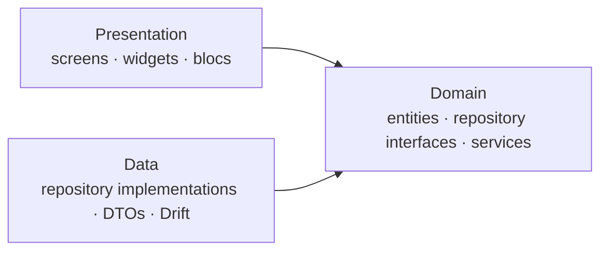

<p align="center">
  
</p>

<h1 align="center">Parkomat.ba</h1>

<p align="center">
  Every parking spot in the city on one 3D map, and zones paid with one SMS. A map-first parking app for Sarajevo, on iOS, Android and the web.
</p>

<p align="center">
  <a href="https://github.com/LjubijankicAmir/parkomat.ba/actions/workflows/ci.yml"></a>
  
  
</p>

---

Parking in Sarajevo is split between street zones paid by SMS, shopping-centre and underground garages, and open lots, each with its own prices, hours and height limits. Parkomat.ba puts all of them on one fluid 3D map, so you can see what's around you and what it costs before you get there. Paying a street zone takes one SMS: you pick the zone, the app fills in the number and your plate, and you send it. There are no accounts and no in-app payments, and it works offline. Banja Luka, Mostar and Tuzla come next.

> **Status:** early development. The project foundation is in place; features land phase by phase (see [Roadmap](#roadmap)).

## Features

- **A 3D map of every parking option**: garages, underground garages, open lots and street zones, over Sarajevo's valley in 3D
- **Instant filters** by price per hour, opening hours, type and entrance height
- **Pay a zone with one SMS**: you choose the zone, the app fills in the number and your plate, and your phone's messages app sends it
- **Your plates stay on your phone**, entered in a real BiH plate field that only accepts valid plates
- **Works offline**: the map, prices and paying by SMS keep working without internet
- **Bosnian and English**, with Bosnian for anyone whose phone speaks a language of the region
- **Light and dark themes**, designed as equals
- **A web app** for browsing parking from any browser

## Download

Android APKs are attached to each [release](https://github.com/LjubijankicAmir/parkomat.ba/releases). Install the latest one on your phone to try the app.

## Roadmap

| Phase | Scope | Release |
| --- | --- | --- |
| 0. Foundation | Architecture, theme, DI, routing, localization, database, CI | |
| 1. Map | The 3D map with Sarajevo's garages, lots and zones, filters and details | `v0.1.0` |
| 2. Pay | Vehicles, the zone picker and paying by SMS, onboarding | `v0.2.0` |
| 3. Offline and web | Offline map and data, the browse-only web app, reporting mistakes | `v0.3.0` |
| 4. More cities | Banja Luka, Mostar and Tuzla | `v1.0.0` |

## Tech stack

| Concern | Choice |
| --- | --- |
| State management | [flutter_bloc](https://pub.dev/packages/flutter_bloc) |
| Local database | [Drift](https://pub.dev/packages/drift) (SQLite, WebAssembly on the web) |
| Dependency injection | [get_it](https://pub.dev/packages/get_it) + [injectable](https://pub.dev/packages/injectable) |
| Routing | [auto_route](https://pub.dev/packages/auto_route) |
| Error handling | [fpdart](https://pub.dev/packages/fpdart) `Either` |
| Immutable models | [freezed](https://pub.dev/packages/freezed) |
| Localization | `gen_l10n` with ARB files |
| Linting | [very_good_analysis](https://pub.dev/packages/very_good_analysis) |

## Architecture

Parkomat.ba follows a layer-first clean architecture with three layers. Dependencies point inward: presentation and data both depend on the domain, and the domain depends on nothing.



```
lib/
├── core/           # Cross-cutting setup: DI, theme, routing, l10n, error types
├── data/           # Datasources (Drift), DTOs and repository implementations
├── domain/         # Entities, repository interfaces, value objects, domain services
└── presentation/   # One folder per feature: bloc, screens, widgets
```

- **Blocs talk to repositories directly.** There are no use-case classes. Logic that spans several repositories, such as deciding whether a zone charges right now, lives in pure-Dart domain services.
- **Errors are values.** Repositories return `Result<T>` (`Either<Failure, T>`) instead of throwing, so every failure path is visible in the types.
- **Repositories are interfaces in the domain** and implemented in the data layer, which keeps blocs testable with simple fakes.

## Getting started

Requires Flutter **3.47** or newer.

```bash
flutter pub get
dart run build_runner build
flutter run
```

Generated code (`*.g.dart`, `*.freezed.dart`, `*.gr.dart`, `*.config.dart`) isn't committed. Run `build_runner` after cloning or pulling, or keep `dart run build_runner watch` running while you work.

```bash
flutter analyze
flutter test
```

On the web, the database runs SQLite as WebAssembly. `web/sqlite3.wasm` and `web/drift_worker.js` come from the [drift release](https://github.com/simolus3/drift/releases) that matches the locked `drift` version; update them together when drift is upgraded.

## Contributing

Work happens on feature branches that are squash-merged into `main` through pull requests. Commit messages and PR titles follow [Conventional Commits](https://www.conventionalcommits.org/) (`feat(map): show garages as 3D extrusions`), and CI checks formatting, analysis, tests, an Android build and a web build on every PR.

## License

The source code is available under the [MIT License](LICENSE).

The Parkomat.ba name, the logo, the app icon and the splash artwork are not covered by that license. Please don't use them in your own published apps. The bundled fonts, [Bricolage Grotesque](assets/fonts/BricolageGrotesque-OFL.txt) and [Onest](assets/fonts/Onest-OFL.txt), are licensed under the SIL Open Font License 1.1.
